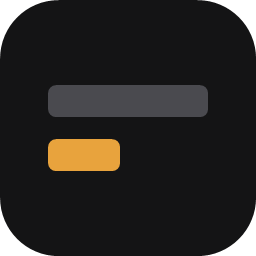
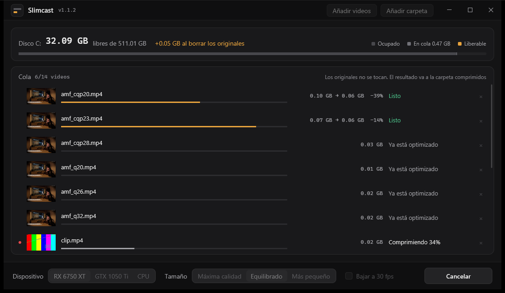

<p align="center"></p>

<h1 align="center">Slimcast</h1>

<p align="center">Comprime tus grabaciones y directos de OBS a HEVC y recupera espacio en el disco, sin perder calidad visible.</p>

<p align="center"><a href="https://github.com/VuloB1/Slimcast/releases/latest"><b>Descargar para Windows y Linux</b></a> · <a href="README.md">English</a></p>



## Qué hace

- Convierte tus videos a **HEVC (H.265)** con la gráfica que elijas, o con la CPU:
  - Windows: NVIDIA (NVENC), AMD (AMF), Intel (Quick Sync, sin probar).
  - Linux: NVIDIA (NVENC), AMD e Intel (VAAPI, sin probar en hardware real).
- Detecta las gráficas del equipo y prueba cada una antes de ofrecerla.
- **Nunca toca los originales.** El resultado va a una carpeta `comprimidos` junto al video, y se descarta si no queda más pequeño o si su duración no coincide.
- Antes de empezar comprueba que haya espacio libre en el disco, y muestra cuánto liberarías si borras los originales.
- Copia el audio tal cual (todas las pistas) y, si quieres, baja a 30 fps.
- Muestra una **miniatura** de cada video para reconocerlo de un vistazo.
- **Scroll suave** y fluido aunque añadas una carpeta con cientos de videos, con barras de progreso que avanzan de forma continua.
- **Se actualiza sola**: avisa cuando hay una versión nueva y la instala con un clic.
- En **6 idiomas**: español, inglés, portugués, japonés, chino y coreano. Usa el idioma del sistema (o el que pongas en la variable `SLIMCAST_LANG=es|en|pt|ja|zh|ko`).
- Es ligera: está hecha en Rust con [GPUI](https://www.gpui.rs/) y usa unos 50 MB de RAM.

Con un directo real de 30,7 GB, el resultado fue de 13,2 GB (−57 %).

## Instalación

Descárgalo desde [Releases](https://github.com/VuloB1/Slimcast/releases/latest). Todas las versiones traen ffmpeg incluido.

### Windows

Ejecuta `Slimcast-x.y.z-setup.exe`. No necesita permisos de administrador.

> NVIDIA: probado con el driver 582. Las versiones de ffmpeg posteriores a la 8.0.1 piden el driver 610 o superior, por eso la app usa la 8.0.1.

### Linux

Dos opciones, las dos de 64 bits (x86_64):

- **AppImage**: un solo archivo, sin instalar nada. Hazlo ejecutable y ábrelo:

  ```sh
  chmod +x Slimcast-x.y.z-x86_64.AppImage
  ./Slimcast-x.y.z-x86_64.AppImage
  ```

  Necesita glibc 2.35 o más nueva (Ubuntu 22.04, Debian 12, Fedora 36 y posteriores). En RHEL, AlmaLinux o Rocky 9, usa el Flatpak.
- **Flatpak**: se instala como cualquier otra app y aparece en el menú de aplicaciones.

  ```sh
  flatpak install --user Slimcast-x.y.z-x86_64.flatpak
  ```

  Flatpak descarga solo lo que necesita desde Flathub. Slimcast en sí no está en Flathub.

Las dos necesitan un driver de gráfica con Vulkan, que tiene cualquier escritorio actual. Probado (en WSL) en Ubuntu 24.04, Debian 13, Fedora 43 y Arch con X11, y en Wayland con Weston. La compresión por gráfica en Linux aún no se ha probado en hardware real: si lo pruebas, un issue contando cómo fue ayuda mucho.

### Actualizaciones

Al abrirse, Slimcast consulta la última release de este repositorio. Si hay una versión más nueva, aparece un aviso con el botón **Actualizar**. Si estás comprimiendo, espera a que termine.

- **Windows**: descarga el instalador, actualiza sin preguntar nada y vuelve a abrir el programa.
- **AppImage**: descarga el AppImage nuevo, sustituye el actual y vuelve a abrirse. Si no puede escribir en esa carpeta, abre la página de la versión.
- **Flatpak**: abre la página de la versión para descargarla.

Solo instala archivos de las [releases de VuloB1/Slimcast](https://github.com/VuloB1/Slimcast/releases) y sin conexión funciona igual. Las versiones 1.0.0 y 1.1.0 de Windows no tienen actualizador: si tienes una de ellas, instala la última a mano una vez.

## Compilar desde el código

Requisitos: [Rust](https://rustup.rs/) y ffmpeg en el PATH.

```sh
cargo run --release   # la app, usando el ffmpeg del PATH
```

- **Instalador de Windows**: necesita [Inno Setup 6](https://jrsoftware.org/isinfo.php) y ffmpeg 8.0.1 (`winget install Gyan.FFmpeg --version 8.0.1`), y luego `powershell -ExecutionPolicy Bypass -File installer\build.ps1`. `installer\art.ps1` vuelve a generar el icono y las imágenes del instalador.
- **Linux**: necesita las librerías de GPUI (`clang pkg-config libxkbcommon-dev libxkbcommon-x11-dev libwayland-dev libvulkan-dev libx11-xcb-dev libxcb1-dev libfontconfig-dev libfreetype-dev` en Ubuntu). `packaging/linux/build-appimage.sh` genera el AppImage y `packaging/flatpak/build-flatpak.sh` el Flatpak. Compila en Ubuntu 22.04 o anterior para que el AppImage funcione en distros más nuevas.

Para publicar una versión nueva, sube `version` en `Cargo.toml`, genera el instalador de Windows y crea una release con la etiqueta `vX.Y.Z` y el `Slimcast-X.Y.Z-setup.exe` adjunto. GitHub Actions genera entonces el AppImage y el Flatpak y los añade a la misma release. Las copias instaladas la detectan al abrirse.

Los textos de la interfaz están en `src/i18n.rs`: una fila por texto, con todos los idiomas lado a lado.

También hay un script de línea de comandos más simple, `comprimir.py` (solo NVENC o CPU): arrastra videos encima de `comprimir.bat`.

## Licencia

[GPL-3.0](LICENSE).

- El instalador de Windows incluye [FFmpeg](https://ffmpeg.org/) 8.0.1 (build *full* de [gyan.dev](https://www.gyan.dev/ffmpeg/builds/)).
- El AppImage y el Flatpak incluyen FFmpeg 8.0.1 (build *gpl-shared* de [BtbN/FFmpeg-Builds](https://github.com/BtbN/FFmpeg-Builds), `autobuild-2026-02-28-12-59`).

Los dos se distribuyen bajo GPL-3.0. El código fuente de FFmpeg está en [FFmpeg/FFmpeg@n8.0.1](https://github.com/FFmpeg/FFmpeg/tree/n8.0.1). Los iconos son de [Lucide](https://lucide.dev/) (ISC, ver `assets/icons/LICENSE`).
