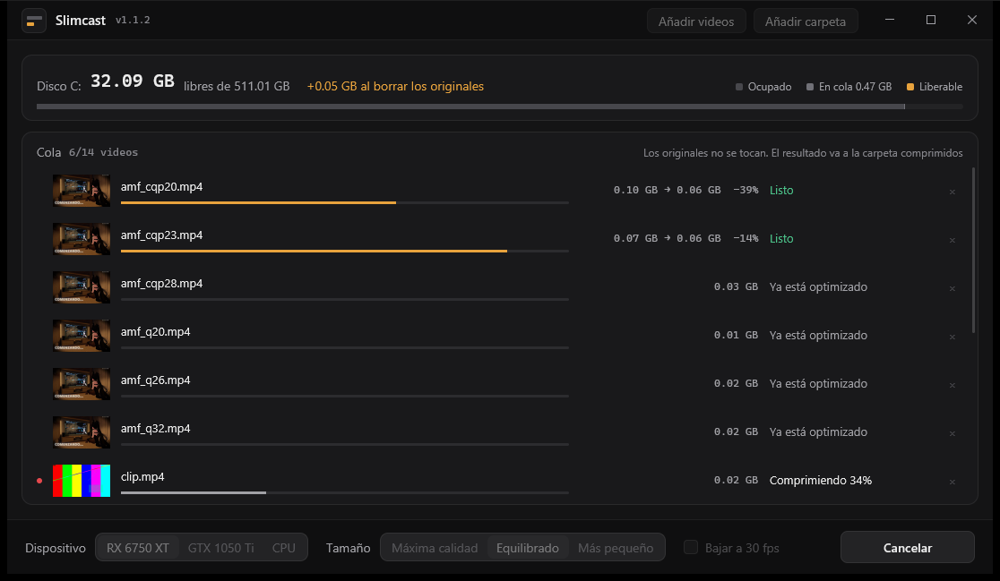

<p align="center"></p>

<h1 align="center">Slimcast</h1>

<p align="center">Compress your OBS recordings and streams to HEVC and get your disk space back, with no visible quality loss.</p>

<p align="center"><a href="https://github.com/VuloB1/Slimcast/releases/latest"><b>Download for Windows</b></a> · <a href="README.es.md">Español</a></p>



## What it does

- Converts your videos to **HEVC (H.265)** on the GPU you choose: NVIDIA (NVENC), AMD (AMF), Intel (Quick Sync, untested) or the CPU.
- Detects the GPUs in your PC and tests each one before offering it.
- **Never touches the originals.** Output goes to a `comprimidos` folder next to the video, and it's discarded if it isn't smaller or its duration doesn't match.
- Checks there's enough free disk space before starting, and shows how much you'd free up by deleting the originals.
- Copies the audio as is (every track) and can lower the video to 30 fps.
- Shows a **thumbnail** of each video so you can spot it at a glance.
- **Smooth scrolling**, even with a folder of hundreds of videos, and progress bars that move continuously.
- **Updates itself**: it tells you when a new version is out and installs it in one click.
- In **6 languages**: English, Spanish, Portuguese, Japanese, Chinese and Korean. It follows your Windows language (or set `SLIMCAST_LANG=en|es|pt|ja|zh|ko`).
- Lightweight: built in Rust with [GPUI](https://www.gpui.rs/), it uses about 50 MB of RAM.

A real 30.7 GB stream came out at 13.2 GB (−57%).

## Install

Download `Slimcast-x.y.z-setup.exe` from [Releases](https://github.com/VuloB1/Slimcast/releases/latest) and run it. It doesn't need admin rights and ffmpeg is included.

### Updates

When it opens, Slimcast checks the latest release of this repository. If there's a newer version, a notice with an **Update** button appears: it downloads the installer, updates silently and reopens the app. If a compression is running, it waits until it's done.

- It only installs files from the [VuloB1/Slimcast releases](https://github.com/VuloB1/Slimcast/releases).
- Offline is fine: the app works the same.
- Versions 1.0.0 and 1.1.0 have no updater. If you have one of them, install the latest by hand once.

> NVIDIA: tested with driver 582. ffmpeg releases after 8.0.1 require driver 610 or newer, so the app ships 8.0.1.

## Build from source

Requirements: [Rust](https://rustup.rs/), [Inno Setup 6](https://jrsoftware.org/isinfo.php) and ffmpeg on the PATH (`winget install Gyan.FFmpeg`).

```powershell
cargo run --release                                          # the app, using ffmpeg from the PATH
powershell -ExecutionPolicy Bypass -File installer\build.ps1 # builds dist\Slimcast-<version>-setup.exe
```

To publish a new version, bump `version` in `Cargo.toml`, build the installer and create a release tagged `vX.Y.Z` with `Slimcast-X.Y.Z-setup.exe` attached. Installed copies pick it up when they open.

Interface texts live in `src/i18n.rs`, one row per text with every language side by side.

`installer\art.ps1` regenerates the icon and the installer artwork.

There's also a simpler command-line script, `comprimir.py` (NVENC or CPU only): drag videos onto `comprimir.bat`.

## License

[GPL-3.0](LICENSE). The installer bundles [FFmpeg](https://ffmpeg.org/) 8.0.1 (the *full* build from [gyan.dev](https://www.gyan.dev/ffmpeg/builds/)), also distributed under GPL-3.0. Its source code is at [FFmpeg/FFmpeg@n8.0.1](https://github.com/FFmpeg/FFmpeg/tree/n8.0.1), and the libraries in the build are listed on [gyan.dev](https://www.gyan.dev/ffmpeg/builds/).
