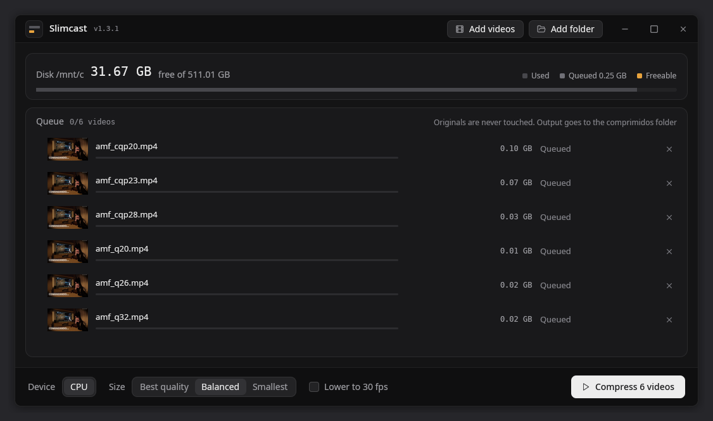

<p align="center"></p>

<h1 align="center">Slimcast</h1>

<p align="center">Compress your OBS recordings and streams to HEVC and get your disk space back, with no visible quality loss.</p>

<p align="center"><a href="https://github.com/VuloB1/Slimcast/releases/latest"><b>Download for Windows and Linux</b></a> · <a href="README.es.md">Español</a></p>


## What it does

- Converts your videos to **HEVC (H.265)** on the GPU you choose, or the CPU:
  - Windows: NVIDIA (NVENC), AMD (AMF), Intel (Quick Sync, untested).
  - Linux: NVIDIA (NVENC), AMD and Intel (VAAPI, untested on real hardware).
- Detects the GPUs in your PC and tests each one before offering it.
- **Never touches the originals.** Output goes to a `comprimidos` folder next to the video, and it's discarded if it isn't smaller or its duration doesn't match.
- Checks there's enough free disk space before starting, and shows how much you'd free up by deleting the originals.
- Copies the audio as is (every track) and can lower the video to 30 fps.
- Shows a **thumbnail** of each video so you can spot it at a glance.
- **Smooth scrolling**, even with a folder of hundreds of videos, and progress bars that move continuously.
- **Updates itself**: it tells you when a new version is out and installs it in one click.
- In **6 languages**: English, Spanish, Portuguese, Japanese, Chinese and Korean. It follows your system language (or set `SLIMCAST_LANG=en|es|pt|ja|zh|ko`).
- Lightweight: built in Rust with [GPUI](https://www.gpui.rs/), it uses about 50 MB of RAM.

A real 30.7 GB stream came out at 13.2 GB (−57%).

## Install

Download it from [Releases](https://github.com/VuloB1/Slimcast/releases/latest). ffmpeg is included in every version.

### Windows

Run `Slimcast-x.y.z-setup.exe`. It doesn't need admin rights.

> NVIDIA: tested with driver 582. ffmpeg releases after 8.0.1 require driver 610 or newer, so the app ships 8.0.1.

### Linux



Two options, both 64-bit (x86_64):

- **AppImage**: one file, no install. Make it executable and open it:

  ```sh
  chmod +x Slimcast-x.y.z-x86_64.AppImage
  ./Slimcast-x.y.z-x86_64.AppImage
  ```

  Needs glibc 2.35 or newer (Ubuntu 22.04, Debian 12, Fedora 36 and later). On RHEL, AlmaLinux or Rocky 9, use the Flatpak.
- **Flatpak**: installs like any other app and shows up in your app menu.

  ```sh
  flatpak install --user Slimcast-x.y.z-x86_64.flatpak
  ```

  Flatpak downloads what it needs from Flathub on its own. Slimcast isn't on Flathub itself.

Both need a GPU driver with Vulkan, which every current desktop has. Tested (in WSL) on Ubuntu 24.04, Debian 13, Fedora 43 and Arch with X11, and on Wayland under Weston. Compression on Linux GPUs hasn't been tried on real hardware yet: if you do, an issue telling how it went helps a lot.

### Updates

When it opens, Slimcast checks the latest release of this repository. If there's a newer version, a notice with an **Update** button appears. If a compression is running, it waits until it's done.

- **Windows**: downloads the installer, updates silently and reopens the app.
- **AppImage**: downloads the new AppImage, replaces the current file and reopens. If it can't write to that folder, it opens the release page instead.
- **Flatpak**: opens the release page to download the new version.

It only installs files from the [VuloB1/Slimcast releases](https://github.com/VuloB1/Slimcast/releases), and works the same offline. Windows versions 1.0.0 and 1.1.0 have no updater: if you have one of them, install the latest by hand once.

## Build from source

Requirements: [Rust](https://rustup.rs/) and ffmpeg on the PATH.

```sh
cargo run --release   # the app, using ffmpeg from the PATH
```

- **Windows installer**: needs [Inno Setup 6](https://jrsoftware.org/isinfo.php) and ffmpeg 8.0.1 (`winget install Gyan.FFmpeg --version 8.0.1`), then `powershell -ExecutionPolicy Bypass -File installer\build.ps1`. `installer\art.ps1` regenerates the icon and the installer artwork.
- **Linux**: needs the GPUI libraries (`clang pkg-config libxkbcommon-dev libxkbcommon-x11-dev libwayland-dev libvulkan-dev libx11-xcb-dev libxcb1-dev libfontconfig-dev libfreetype-dev` on Ubuntu). `packaging/linux/build-appimage.sh` builds the AppImage and `packaging/flatpak/build-flatpak.sh` the Flatpak. Build on Ubuntu 22.04 or older so the AppImage runs on newer distros.

To publish a new version, bump `version` in `Cargo.toml`, build the Windows installer and create a release tagged `vX.Y.Z` with `Slimcast-X.Y.Z-setup.exe` attached. GitHub Actions then builds the AppImage and the Flatpak and adds them to the same release. Installed copies pick it up when they open.

Interface texts live in `src/i18n.rs`, one row per text with every language side by side.

There's also a simpler command-line script, `comprimir.py` (NVENC or CPU only): drag videos onto `comprimir.bat`.

## License

[GPL-3.0](LICENSE).

- The Windows installer bundles [FFmpeg](https://ffmpeg.org/) 8.0.1 (the *full* build from [gyan.dev](https://www.gyan.dev/ffmpeg/builds/)).
- The AppImage and the Flatpak bundle FFmpeg 8.0.1 (the *gpl-shared* build from [BtbN/FFmpeg-Builds](https://github.com/BtbN/FFmpeg-Builds), `autobuild-2026-02-28-12-59`).

Both are distributed under GPL-3.0. FFmpeg's source code is at [FFmpeg/FFmpeg@n8.0.1](https://github.com/FFmpeg/FFmpeg/tree/n8.0.1). Icons are from [Lucide](https://lucide.dev/) (ISC, see `assets/icons/LICENSE`).
